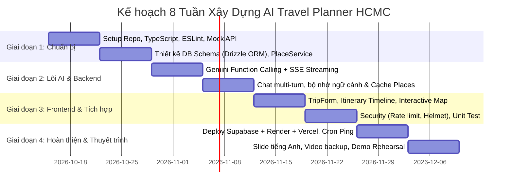

# 🚀 Đề Xuất Cải Thiện & Bổ Sung Chi Tiết: Project Plan Travel AI HCMC

> **Tài liệu tham chiếu:** [Project Plan Travel AI HCMC.md](file:///Users/phamgiahung/Downloads/%C4%90%E1%BB%92%20%C3%81N%20M%C3%94N%20H%E1%BB%8CC/T%C6%AF%20DUY%20T%C3%8DNH%20TO%C3%81N/WEBSITE%20AI%20TRAVEL/Project%20Plan%20Travel%20AI%20HCMC.md)  
> **Người thực hiện đề xuất:** Pair Programming Assistant  
> **Mục tiêu:** Bổ sung các khía cạnh kỹ thuật còn thiếu, tối ưu hóa tính khả thi, độ tin cậy khi demo đồ án và hoàn thiện quy trình phát triển trong 8 tuần.

---

## 1. Tổng quan đánh giá Project Plan hiện tại

### Điểm mạnh nổi bật
- **Phạm vi (Scope) thực tế:** Định hình rõ các tính năng bắt buộc (MVP) và tính năng nâng cao, rất phù hợp cho 1 người làm trong 8 tuần.
- **Thiết kế UI/UX chi tiết:** Bảng màu, typography, responsive breakpoint và micro-animations được chỉ định rõ ràng, có tính thẩm mỹ cao.
- **Prompt Engineering & Tool Calling:** Có sơ đồ phân chia vai trò rõ ràng giữa Gemini AI và Google Places API.

### Các lỗ hổng và rủi ro kỹ thuật cần bổ sung
1. **Chưa có cơ chế Streaming response từ AI:** Chờ 10-15s mới nhận toàn bộ JSON dễ gây cảm giác lag hoặc timeout.
2. **Quản lý Database Migration thiếu sót:** Chuyển đổi SQLite (local) sang PostgreSQL (Supabase) bằng raw SQL rất dễ lỗi cú pháp/kiểu dữ liệu.
3. **Thiếu Pipeline CI/CD & Automated Testing:** Chưa có GitHub Actions để tự động build, lint và test trước khi deploy.
4. **Xử lý Cold-Start của Render:** Render free tier ngủ đông sau 15 phút, nếu chỉ nhắc "mở trước 2-3 phút" rất rủi ro lúc thuyết trình trực tiếp.
5. **Rủi ro Quota & Chi phí Google Places API:** Chưa có cơ chế mock dữ liệu khi dev/test cục bộ.
6. **Xử lý Đa ngôn ngữ (i18n) & Locale Format:** Thuyết trình bằng tiếng Anh nhưng dữ liệu địa điểm, tiền tệ tại TP.HCM là tiếng Việt.

---

## 2. Chi tiết các đề xuất cải thiện

### 2.1. Kiến trúc & Công nghệ (Architecture & Tech Stack)

#### A. Thêm Streaming Response (Server-Sent Events - SSE)
- **Vấn đề:** Khi AI suy luận và gọi Function Calling, thời gian phản hồi có thể kéo dài 10–20 giây. Nếu dùng REST thông thường (`POST /api/trips/:id/chat`), giao diện sẽ ở trạng thái chờ quá lâu.
- **Giải pháp:** Sử dụng **Server-Sent Events (SSE)** hoặc WebSocket cho luồng chat:
  - Backend gửi các event trạng thái: `status: "searching_places"` ➔ `status: "optimizing_budget"` ➔ `token: "..."` ➔ `status: "itinerary_ready"`.
  - Frontend cập nhật progress bar hoặc typing text theo thời gian thực, đem lại trải nghiệm sống động và đáng tin cậy.

#### B. Nâng cấp TypeScript & Linter
- **Vấn đề:** Dự án kết hợp nhiều JSON payload phức tạp (lịch trình nhiều ngày, phản hồi Google Places, function calling args). Viết JavaScript thuần rất dễ dính lỗi `undefined is not an object` khi demo.
- **Giải pháp:**
  - **Client:** Dùng TypeScript (`React + Vite + TypeScript`). Định nghĩa type chặt chẽ cho: `Trip`, `ItineraryItem`, `PlaceDetail`, `ChatMessage`.
  - **Server:** Dùng TypeScript hoặc tối thiểu là **JSDoc + Zod** để parse và validate response từ Gemini API.
  - Cấu hình **ESLint + Prettier** với quy tắc chặt chẽ ngay từ tuần 1.

#### C. Database Migration & ORM nhẹ (Prisma hoặc Drizzle ORM)
- **Vấn đề:** Kế hoạch ghi dùng `SQLite` khi dev và `PostgreSQL` khi production với raw SQL script. Sự khác biệt về kiểu dữ liệu (JSON type, Date type, Auto-increment) giữa 2 engine này rất dễ làm gãy backend khi deploy lên Render/Supabase.
- **Giải pháp:**
  - Sử dụng **Drizzle ORM** (cực nhẹ, hiệu năng cao, zero-dependency) hoặc **Prisma**.
  - Quản lý schema bằng 1 file duy nhất, tự động sinh migration script cho cả SQLite và Postgres mà không cần viết lại câu lệnh SQL.

#### D. State Management phía Client
- **Vấn đề:** `React Context` phù hợp cho state nhỏ. Khi có vừa chat history, vừa itinerary timeline, vừa filter bản đồ, Context dễ gây re-render không cần thiết toàn bộ trang.
- **Giải pháp:** Thay `React Context` bằng **Zustand** (nhẹ < 2KB, không boilerplate, dễ persist vào `localStorage`).

---

### 2.2. Kiểm thử & Đảm bảo chất lượng (Testing & QA)

| Hạng mục | Công cụ đề xuất | Chi tiết triển khai |
|---|---|---|
| **Unit Test** | `Vitest` | Test các hàm xử lý dữ liệu: tính tổng ngân sách, chuyển đổi giờ mở cửa, validate form input, format tiền VND. |
| **API Test / Mocking** | `MSW` (Mock Service Worker) hoặc Mock Gemini SDK | Tạo mock data cho Gemini API và Google Places API để dev và test tự động **không tiêu tốn quota và không cần mạng**. |
| **Integration Test** | `Supertest` (Express) | Test các route chính: `POST /api/trips`, `POST /api/trips/:id/chat`, kiểm tra phản hồi mã HTTP (200, 400, 429). |
| **E2E Smoke Test** | `Playwright` | 1 kịch bản chạy tự động kiểm tra luồng từ Form ➔ Nhập thông tin ➔ Hiển thị timeline kết quả trên giao diện mô phỏng mobile & desktop. |

---

### 2.3. Tự động hóa CI/CD & Quản lý Source Code

Tạo GitHub Actions Workflow `.github/workflows/ci.yml`:
1. **Lint & Type-check:** Chạy `npm run lint` và `tsc --noEmit` mỗi khi push hoặc mở Pull Request.
2. **Automated Test:** Chạy test với mock API để đảm bảo không ai vô tình làm hỏng logic cũ.
3. **Auto Deploy Previews:**
   - Frontend: Vercel preview deployment cho từng nhánh.
   - Backend: Render deploy webhook trigger khi merge vào nhánh `main`.

---

### 2.4. Khắc phục sự cố Render Free Tier Sleep & API Fallback

- **Giải pháp chống ngủ đông (Render Cold-Start):**
  - Tạo endpoint `/api/health` trả về trạng thái DB + uptime.
  - Thiết lập **Cron-job miễn phí** (dùng `cron-job.org` hoặc GitHub Actions scheduled workflow `*/10 * * * *`) để ping `/api/health` mỗi 10 phút, đặc biệt là bật liên tục vào ngày thuyết trình.
- **Bộ dữ liệu Dummy dự phòng (Offline Fallback Mode):**
  - **Rủi ro:** Khi đang đứng trước giảng viên, kết nối Wi-Fi trường học chập chờn, hoặc tài khoản Gemini bị chạm ngưỡng 15 req/phút.
  - **Giải pháp:** Xây dựng cờ `DEMO_MODE=true` trong file `.env`. Nếu bật cờ này hoặc khi API ngoài bị lỗi mạng/quota, server tự động trả về lịch trình mẫu chuẩn (được cache sẵn các quán thật như Phở Hòa, Bảo tàng Chứng tích Chiến tranh, Dinh Độc Lập) với delay giả lập 1.5 giây. **Đảm bảo buổi demo thành công 100% không bao giờ gặp lỗi màn hình trắng**.

---

### 2.5. Bảo mật & Tối ưu Chi phí (Security & Cost Optimization)

1. **Helmet & HTTP Security Headers:** Thêm middleware `helmet()` vào Express để chống XSS, Clickjacking.
2. **Input Sanitization & Zod Validation:**
   - Dùng thư viện `zod` để định nghĩa schema và parse input ở cả client và middleware backend.
   - Giới hạn độ dài chuỗi chat (ví dụ tối đa 300 ký tự) để chống spam token tới Gemini.
3. **Cơ chế Caching 2 tầng cho Google Places:**
   - Tầng 1: In-memory cache (hoặc database `places_cache`) với TTL 7 ngày cho các địa điểm phổ biến tại Q1, Q3.
   - Tầng 2: Giới hạn trường lấy về (Field Masking) từ Google Places API (chỉ lấy `formatted_address`, `geometry`, `name`, `photos`, `rating`, `user_ratings_total`) để tiết kiệm băng thông và chi phí.

---

### 2.6. Trải nghiệm Quốc tế hóa (i18n) & Bản đồ

1. **Giao diện đa ngôn ngữ linh hoạt (EN/VI):**
   - Thuyết trình bằng tiếng Anh, nhưng người dùng hoặc thầy cô có thể muốn xem tên món ăn bằng tiếng Việt (ví dụ: *Bánh Mì Huỳnh Hoa* thay vì dịch máy kỳ lạ).
   - Tích hợp `react-i18next` với switch toggle [🇬🇧 EN / 🇻🇳 VI] ở góc trên thanh Navigation.
2. **Tối ưu Bản đồ tương tác (Google Maps Embed vs Leaflet/Mapbox):**
   - Thay vì nhúng iframe đơn giản, dùng `@react-google-maps/api` hiển thị marker có đánh số thứ tự (1, 2, 3...) tương ứng với các chặng trong ngày. Khi click vào card bên timeline thì bản đồ tự pan & zoom đến địa điểm đó.

---

## 3. Điều chỉnh Bảng Timeline 8 tuần thực tế

Dưới đây là kế hoạch phân bổ lại để đưa các đề xuất cải thiện vào mà không làm quá tải khối lượng công việc của 1 người:

| Tuần | Thời gian | Trọng tâm công việc | Deliverable chính |
|---|---|---|---|
| **1** | 15/10 – 21/10 | **Setup chuẩn hóa:** Khởi tạo project với TypeScript, ESLint, Prettier, GitHub Actions CI cơ bản. Tạo mock data cho địa điểm và AI. | Boilerplate chạy được, CI pass xanh. |
| **2** | 22/10 – 28/10 | **Database & Dịch vụ Địa điểm:** Setup Drizzle ORM (SQLite local), viết `placeService.js` gọi Google Places API kèm cache DB. | CRUD trips hoạt động, cache địa điểm chạy trơn tru. |
| **3** | 29/10 – 04/11 | **AI Core & Function Calling:** Tích hợp Gemini Flash SDK, cấu hình tools (`searchPlaces`, `getPlaceDetails`), thiết lập streaming/SSE. | AI gọi tool và sinh lịch trình JSON đúng cấu trúc. |
| **4** | 05/11 – 11/11 | **Multi-turn Chat & Logic sửa đổi:** Xử lý hội thoại qua lại, AI ghi nhớ lịch sử và cập nhật từng phần lịch trình. Tạo cờ `DEMO_MODE`. | Luồng chat tương tác hoàn chỉnh qua API. |
| **5** | 12/11 – 18/11 | **Frontend UI/UX:** Dựng TripForm, ChatPanel, Itinerary Timeline, kết nối bản đồ Google Maps, xử lý animation mượt mà (framer-motion). | Giao diện hoàn chỉnh, responsive trên mobile/desktop. |
| **6** | 19/11 – 25/11 | **Security & Testing:** Tích hợp `helmet`, `express-rate-limit`, `zod` validator; viết 10 unit tests + 1 test kịch bản Playwright E2E. | Backend bảo mật, code coverage logic lõi đạt yêu cầu. |
| **7** | 26/11 – 02/12 | **Deploy & Đồng bộ Production:** Deploy Frontend (Vercel), Backend (Render), DB (Supabase). Setup cron ping chống sleep Render. | Bản live public chạy ổn định trên Internet. |
| **8** | 03/12 – 09/12 | **Tài liệu, Slide & Tập dượt:** Soạn slide thuyết trình tiếng Anh, viết README chi tiết, quay video demo backup, luyện tập thuyết trình. | Sẵn sàng 100% cho buổi chấm đồ án. |

---

## 4. Checklist bổ sung trước ngày nộp bài

- [ ] **Mã nguồn:** Chuyển đổi và kiểm tra TypeScript types đầy đủ, không còn lỗi linter.
- [ ] **Chế độ Demo An Toàn:** Cài đặt sẵn toggle `DEMO_MODE` để tự tin trình diễn khi mạng lag.
- [ ] **Chống ngủ đông:** Cấu hình cron ping URL `/api/health` để Render luôn thức.
- [ ] **Tài liệu API:** Xuất file OpenAPI / Swagger hoặc Postman Collection chia sẻ trong README.
- [ ] **Video sao lưu:** Quay sẵn 1 video demo màn hình full HD (3 phút) có thuyết minh phụ đề tiếng Anh phòng trường hợp máy chiếu hoặc mạng trường gặp sự cố.
